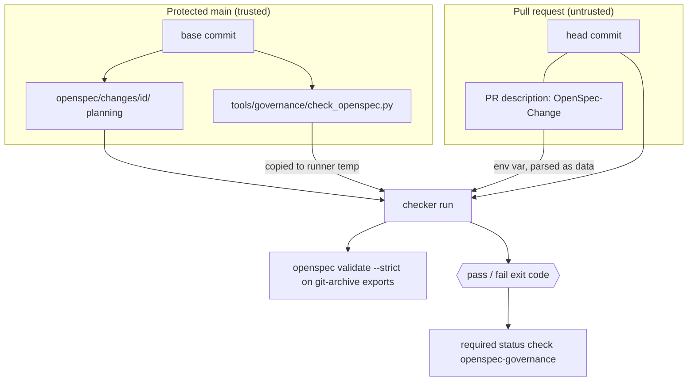

# Design

## Context

See proposal.md (Why, Current Behavior). Constraints: the repository is private and owned by a
personal account (GitHub reports rulesets unavailable without Pro or a public repository); the
author of this change has `write`, not `admin`; Python 3.11 in CI, no project lockfile; private
competition data must never be read by cloud-hosted models, so the gate cannot depend on it.

## Target Architecture

Agents: `AGENTS.md` §0 is canonical; `CLAUDE.md` imports it; OpenSpec skills/commands live in
`.claude/` (Claude Code) and `.agents/skills/openspec-*` (Codex).

## Affected Components

- `openspec/`: `config.yaml` (default schema `pulse-governed`, context, rules, operation
  guidance), `schemas/pulse-governed/` (schema + 5 templates), `changes/`, `specs/`.
- `tools/governance/check_openspec.py`: the gate. `tests/governance/test_check_openspec.py`.
- `.github/workflows/governance.yml`, `.github/pull_request_template.md`, `.github/CODEOWNERS`.
- `.claude/` (generated commands/skills + `settings.json` deny list), `.agents/skills/openspec-*`
  and `.agents/skills/.openspec-target` (generated), `CLAUDE.md`, `AGENTS.md` (section 0 added),
  `docs/OPEN_SPEC_WORKFLOW.md`, `DEVELOPING.md` (pointer).

## Data Flow and Interfaces

Checker CLI: `--mode pr --base <rev> --head <rev> [--change id] [--pr-body-env VAR]
[--base-ref-name name] [--protected-branch main] [--trusted-ref ref] [--run-openspec]` and
`--mode audit --rev <rev>`. Exit 0 pass, 1 policy failure, 2 Git/usage error.

1. Resolve base/head to commits (reject option-like revisions); compute the merge-base.
2. `git diff --raw -z --no-renames` → entries (renames become delete + add, so both paths are judged).
3. Reject unsafe paths, symlinks, submodules, type changes; read the declared id from `--change`
   and the `OpenSpec-Change:` line of the PR body (HTML comments stripped; conflicts fail).
4. Bootstrap if the base has neither checker nor config; otherwise classify paths into planning
   (per change), archive, main specs, protected and implementation.
5. Specification PR: one change's planning only; artifacts validated at head; no evidence, no
   newly checked tasks. Implementation PR: declared change must exist at base; approved artifacts
   validated at base; scope, protected paths, algorithm type, tests, task-text immutability,
   evidence and archive integrity validated at head.
6. Optionally run `openspec validate --strict` on read-only `git archive` exports of the revision.

Change scope uses OpenSpec's native `.openspec.yaml` field `affected_areas` (path globs).

## Decisions and Alternatives

- **Approval = presence in the protected base**, not a flag/label/comment (all writable by the
  judged party). Trade-off: depends on branch protection being enabled.
- **Base copy of the checker in CI** so a PR cannot weaken its own gate; bootstrap is the only
  time the head copy runs, and only in bootstrap mode.
- **Scope by `affected_areas` globs** instead of exact file lists: flexible inside approved areas;
  protected paths require a pattern rooted in them so `**`-style patterns cannot authorise them.
  Patterns must start with a literal path.
- **Fork `spec-driven`** rather than a new schema: keeps OpenSpec's delta-spec validation and
  archive semantics. `verification.md` is a template + checker rule, because schema version 1
  supports only artifacts and `apply`, and making it an artifact would invite generating it
  during planning.
- **stdlib-only Python** (own minimal YAML subset parser, `unittest`): no new dependencies; the
  parser fails closed on unsupported syntax.
- **Expanded workflows via a temporary `XDG_CONFIG_HOME`** profile: no change to the user's global
  OpenSpec config.

## Dependencies

No new Python dependency. CI installs pinned tools only in the runner: `@fission-ai/openspec@1.13.1`
(Node 20.19.0) and `ruff==0.6.9`. Actions pinned to commit SHAs: checkout v4.3.1, setup-python
v5.6.0, setup-node v4.4.0.

## Complexity and Performance

O(changed files + files in the referenced change) Git calls; the 66-test suite runs in about 21 s
locally; the CI job has a 15-minute timeout.

## Reproducibility

The checker is deterministic for fixed base/head commits (Git object reads only, sorted
iteration). Tool versions are pinned in CI. No cache.

## Testing Strategy

`tests/governance/test_check_openspec.py` builds temporary Git repositories and runs the checker
as a subprocess: 8 expected successes, 5 bootstrap cases, 48 bypass attempts, and repository
wiring tests (templates match checker sections, config selects the schema, workflow is
least-privilege, pinned and fail-closed, CLAUDE.md imports AGENTS.md, a failing test propagates a
non-zero exit, OpenSpec schema/spec validation). The submission-contract spec is verified with
synthetic CSVs against the unmodified official validator in a scratch directory.

## Security and Confidentiality

The checker and tests never open `data/`, videos, ATD, homographies, Smart Tagging, caches or
prediction files, and never run the engine. `.claude/settings.json` denies Claude Code reads of
those paths (defence in depth, not a boundary: Bash can still read files). The workflow uses
`pull_request` with `contents: read`, no secrets, `persist-credentials: false`, and passes the PR
body via an environment variable. During this change only code, configuration and public docs
were read; synthetic CSVs were generated outside the repository.

## Compatibility

No application code changes; existing CI (`ci.yml`) and pre-commit configuration are untouched.
Existing custom skills (`mtah-eval`, `possession-pipeline`) are preserved; `AGENTS.md` §0 takes
precedence where they conflict (for example, the skill's hardcoded kickoff frames).

## Rollback and Migration

Rollback: revert the bootstrap merge commit and drop the required check. Migration for
contributors: install OpenSpec 1.13.1, read `docs/OPEN_SPEC_WORKFLOW.md`, open specification PRs
for in-flight work. The audit's P0 fixes become the first governed changes.
