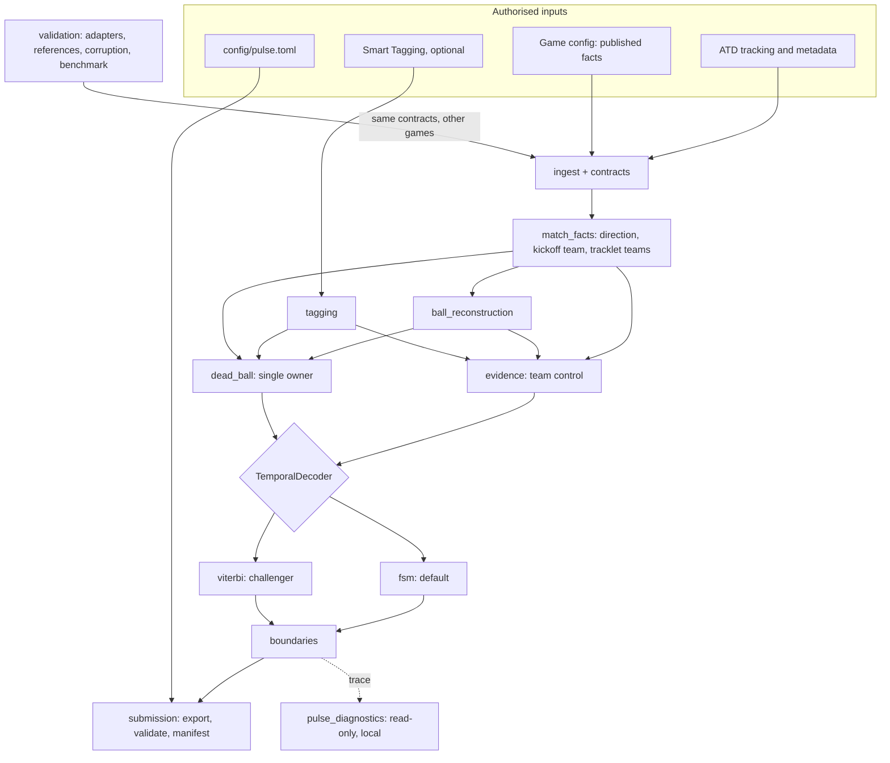
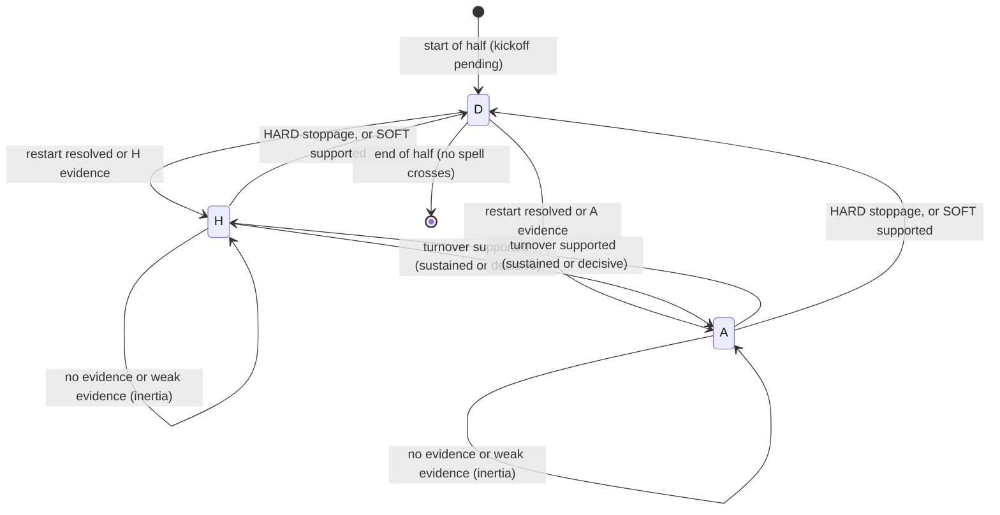
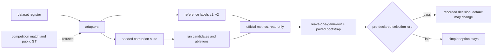
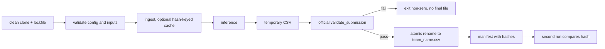
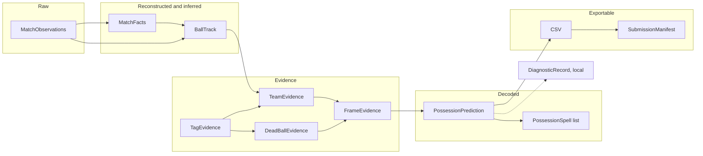

# Design

> **PULSE** = Possession Understanding through Latent State Estimation. Status: proposed, not
> approved. Code references are to `origin/main` at `54998ee`. No claim in this document comes from
> running the code on match data.

## Summary

PULSE is a controlled evolution of the existing engine, not a replacement. It keeps the inertia idea
and the working stages, and adds four things the project lacks: compliance by construction, one
reproducible path, typed layers between stages, and an evaluation signal that does not touch the
provided game. New probabilistic parts compete with the refactored FSM behind one interface and are
adopted only under a pre-declared rule.

Reading guide: `README.md` (Spanish, for reviewers), `supporting/current-architecture.md` (evidence
matrix), `supporting/technology-review.md`, `supporting/external-validation-protocol.md`,
`supporting/roadmap.md`, `supporting/architecture-review.md`.

## Context

**Current pipeline.** `run_experiment.build_match_context` parses ATD and Smart Tagging and builds a
`TrackingContext`. `FootballEngineStrategy.predict` then runs seven phases on it. `pipeline/runner.py`
is a second, older path: same inputs, a different FSM (`pipeline/state_machine.py`), interpolated
ball, a different output file. `APPROACH.md` documents the `run_experiment.py` path.

**Measured structure of `strategies/football_engine.py`** (static AST count, no execution): 1,405
lines, 708 numeric literals (87 distinct, 307 outside {-1, 0, 1, 2}).
`_resolve_physical_turnovers` has 547 lines and 205 branch or loop nodes.

**Constraints.** 25 fps, 199,319 frames, ball absent on 41% of graded frames, 46 unstable slots, 2D
projection of aerial balls, 12 days to the deadline, no leaderboard, three people, and an agent
workflow that cannot touch private data. Humans run anything that needs the match data.

**Stacking note.** This branch derives from `5e094e2` plus the governance bootstrap. It does not
contain the 20 later commits on `main`, so implementation must branch from `main` after both PRs merge.

## Goals and Non-Goals

Goals: a valid, reproducible, rule-compliant submission first; then measurable reduction of false
splits and false stoppages on independent games; then explainability.

Non-goals: a guaranteed score, real-time inference, video detection, a rewrite, a labelling tool,
cloud services, or any tuning against the competition match.

## Target Architecture

The ten modules of the brief map onto existing files wherever possible. Only `validation/`,
`config/` and `make_submission.py` are new at top level.

| # | Module | Location | Decision |
|---|---|---|---|
| 1 | Data ingestion & normalization | `pipeline/ingest.py`, `pipeline/contracts.py`, `pipeline/match_facts.py` | REFACTOR the two ATD parsers into one; EXTEND `TrackingContext` |
| 2 | Ball recovery | `pipeline/ball_reconstruction.py` | EXTEND; EXPERIMENTAL until gated |
| 3 | Team control | `pipeline/evidence.py` | EXTEND and vectorise; absorbs phase 3 |
| 4 | Dead ball | `pipeline/dead_ball.py` | REFACTOR into the single owner; absorbs phases 2 and 6 |
| 5 | Smart Tagging fusion | `pipeline/tagging.py` | REFACTOR parser out of `dead_ball.py`; extra fusion EXPERIMENTAL |
| 6 | Temporal inference | `pipeline/temporal/fsm.py`, `pipeline/temporal/viterbi.py`, `pipeline/temporal/boundaries.py` | KEEP the FSM logic, REFACTOR it; `hmm_viterbi.py` REPLACED by a gated challenger |
| 7 | Confidence | part of `pipeline/temporal/` | EXTEND; reporting only |
| 8 | Visual debugger | `tools/pulse_diagnostics.py` | EXTEND `generate_subtitles.py` |
| 9 | External validation | `validation/` | NEW |
| 10 | Submission | `make_submission.py`, `pipeline/submission.py`, `config/pulse.toml` | NEW; `pipeline/runner.py` DEPRECATED |

`strategies/football_engine.py` stays registered as a frozen reference until gate G2, then becomes a
thin `PulseStrategy` wrapper. Other strategies stay available as experiments; they are not production.

### Component architecture



### Temporal inference flow



### Experiment and validation flow



### Submission flow



## Affected Components

KEEP / REFACTOR / EXTEND / REPLACE / DEPRECATE / EXPERIMENTAL decisions per file are in
`supporting/current-architecture.md`, with evidence labels. Main effects:

- `strategies/football_engine.py`: constants removed first, then stages moved out unchanged in behaviour.
- `pipeline/runner.py`, `pipeline/state_machine.py`: retired. Their ideas (lookahead) are compared as FSM options.
- `run_experiment.py`: delegates loading to `pipeline/ingest.py`. `--test-all` fails properly. It stops scoring automatically against public GT.
- `tests/test_golden_spells.py`, `tests/baseline/*`, floors in `tools/regression_check.py`, `tools/sweep_hysteresis.py`: removed or rewritten.
- `AGENTS.md` section 7, `DEVELOPING.md`, `.agents/skills/possession-pipeline/`: instructions to add golden cases and hardcoded kickoff guidance are removed.
- `evaluation/**`, `starter/**`: untouched and used as they are.

## Data Flow and Interfaces



All contracts are frozen dataclasses of NumPy arrays in `pipeline/contracts.py`, with arrays set
read-only and a `validate()` run at construction. `n` = frames, `k` = slots. Position fields are
metres in the pitch frame, origin at a corner, x along the length. Time derives from `frame / fps`.

### GameConfig (input layer)
- **Responsibility:** organiser-published per-game facts only.
- **Fields:** `game_id: str`, `fps: int`, `n_frames: int`, `pitch_m: (float, float)`, `frame_id_base: int`, `graded: tuple[(int, int), ...]`, `kickoffs: dict[int, int]`.
- **Missing:** no missing values; a validated external game may omit `graded` and `kickoffs`.
- **Invariants:** intervals sorted, disjoint, inside `[0, n_frames)`.
- **Producer:** `games.py`. **Consumers:** ingestion, exporter.
- **Compatibility:** wraps `GAMES`, `half_video_blocks`. No team, side or slot fields exist.

### MatchObservations (raw)
- **Responsibility:** untouched observations.
- **Fields:** `ball_xy (n,2) float32`, `ball_valid (n) bool`, `player_xy (n,k,2) float32`, `player_valid (n,k) bool`, `slot_team_meta (k) int8` (0, 1, -1 unknown), `half (n) int8` (0 outside play, 1, 2).
- **Missing:** NaN plus false validity. Never zero.
- **Invariants:** validity equals `~isnan`. Length `n`.
- **Producer:** `ingest`. **Consumers:** every later stage.
- **Compatibility:** `TrackingContext` is produced from it during migration by an adapter; strategies keep working.

### MatchFacts (inferred)
- **Responsibility:** per-match knowledge derived by algorithm.
- **Fields:** `attack_dir: dict[(half, team), int]` (+1, -1, 0 unknown), `kickoff_team: dict[half, int]` (-1 unknown), `tracklet_team (n,k) int8`, `tracklet_team_conf (n,k) float16`, `source: dict[str, str]`.
- **Missing:** 0 or -1 disables direction or team dependent logic for that half.
- **Invariants:** opposite directions per half when both are known.
- **Producer:** `match_facts`. **Consumers:** evidence, dead ball.
- **Compatibility:** replaces `_resolve_slot_team` and every per-half side branch.
- **Method:** direction from the sign of the median team centroid per half, robust to a few wrong tracklets. Goalkeeper-like segments: per team, the persistently deepest tracklet segment, compared with the defending end. Kicking team: first touch after the kickoff configuration, else a kickoff tag, else unknown.

### BallTrack (reconstructed)
- **Responsibility:** ball position used by evidence, with its state.
- **Fields:** `xy (n,2) float32`, `state (n) uint8` (OBSERVED=0, INTERPOLATED=1, ESTIMATED=2, UNKNOWN=3), `sigma_m (n) float32`, `speed_mps (n) float32`, `velocity_mps (n,2) float32`.
- **Missing:** UNKNOWN frames have NaN position, sigma and speed. Speed needs two consecutive valid samples, otherwise NaN.
- **Invariants:** OBSERVED equals raw exactly. sigma is 0 for OBSERVED.
- **Producer:** `ball_reconstruction`. **Consumers:** evidence, dead ball.
- **Compatibility:** with estimation off, it is a pure view of raw data. It fixes the `b_speed` NaN-to-zero defect, which changes behaviour of rules that read speed; those are checked locally in the equivalence step.

### TeamEvidence
- **Responsibility:** control evidence per frame.
- **Fields:** `score (n,4) float32` for H, A, NONE, INSUFFICIENT; `dist_m (n,2) float32`; `margin_m (n) float32`; `touch_team (n) int8`; `contested (n) bool`; `is_calibrated: bool`.
- **Missing:** INSUFFICIENT active, the H and A scores 0; distances NaN (not the sentinel 99.0 now in use).
- **Invariants:** finite scores. `is_calibrated` is true only with a calibration report id.
- **Producer:** `evidence`. **Consumers:** decoders, restarts.

### DeadBallEvidence (includes RestartEvidence)
- **Responsibility:** the only source of stoppages.
- **Fields:** `level (n) uint8` (NONE, SOFT, HARD); `cause (n) uint8`; `restarts: tuple[RestartEvidence, ...]` with `frame: int`, `team: int` (-1 unknown), `kind: str`, `source: str`, `strength: float`.
- **Missing:** unknown team stays -1. No guessing.
- **Invariants:** restarts sorted and unique by frame. Published pre-kickoff graded intervals are HARD.
- **Producer:** `dead_ball`. **Consumers:** decoders.
- **Compatibility:** replaces `dead_ball_mask` and `restarts`; adapter maps HARD to `"D"`.

### TagEvidence
- **Responsibility:** normalised Smart Tagging.
- **Fields:** tuple of `TagEvent(start, end, code, kind, team (-1 unknown), strength_class, raw_id)`.
- **Missing:** empty tuple is valid.
- **Producer:** `tagging`. **Consumers:** dead ball, evidence (weak context).
- **Compatibility:** replaces `smart_tagging_stoppages` dicts.

### FrameEvidence
- **Responsibility:** the immutable bundle handed to a decoder: `team`, `dead`, `ball_state`, `half`, `graded`.
- **Producer:** pipeline assembler. **Consumers:** decoders. **Invariants:** same `n` in every member.

### PossessionPrediction and PossessionSpell
- **Responsibility:** decoded states and derived spells.
- **Fields:** `labels (n) <U1`; `transition_uncertainty: tuple[UncertaintyRecord, ...]`; `decoder: str`. Spell: `start`, `stop` (half-open), `team`, `half`, `support: float`, `cause: str | None`.
- **Invariants:** labels within H, A, D, X. X only on ungraded frames. Spells derived from labels, never stored independently. No spell crosses a half.
- **Producer:** decoder and boundaries. **Consumers:** exporter, diagnostics.
- **Compatibility:** `labels` is what `BaseStrategy.predict` returns today.

### DiagnosticRecord
- **Responsibility:** local explanation of a segment.
- **Fields:** `start`, `stop`, `label`, `rules: tuple[str, ...]`, `evidence_summary`, `ball_state_share`, `flags`.
- **Consumers:** humans only. Pipeline stages never read it.

### SubmissionManifest
- **Fields:** `commit`, `dirty`, `config_sha256`, `input_sha256: dict`, `python`, `packages`, `decoder`, `tags_used`, `cache_used`, `output_sha256`, `elapsed_s`, `peak_mb`.
- **Invariants:** contains no labels and no coordinates. **Producer:** `pipeline/submission.py`.

### TemporalDecoder interface

```python
class TemporalDecoder(Protocol):
    name: str
    def decode(self, evidence: FrameEvidence, params: DecoderParams) -> PossessionPrediction: ...
```

## Decisions and Alternatives

| ID | Decision | Alternatives rejected | Why |
|---|---|---|---|
| AD1 | Evolve inside `pipeline/` and `strategies/` | New `pulse/` package; full rewrite | Least duplication and churn near a deadline |
| AD2 | Published facts in config, everything else inferred | Keep constants in one file | Frame counts and graded intervals are contract; side, team and slot facts are not published as inputs and must generalise |
| AD3 | Remove golden frame tests from the tree, keep history | Keep them as "regression only" | `RULES.md` excludes hand labels on the provided game for validation too |
| AD4 | Replace with mirror, swap, slot-permutation and synthetic scenario tests | Snapshot of own output | Snapshots of match labels cannot be tracked, and they encode no truth |
| AD5 | Classify rules A, B, C | Delete all, or keep all | Class A is a plain conflict. Class B is general logic with case-derived thresholds and needs evidence or a ruling. Class C has physical logic only. See `supporting/current-architecture.md` |
| AD6 | Separate evidence from decoding | Keep rules acting on labels | Enables ablation, decoder comparison and explanations |
| AD7 | FSM stays default; Viterbi is a challenger; HSMM only on measured need | Immediate switch | No evidence yet; lowest risk |
| AD8 | Own ~100-line NumPy decoder | `hmmlearn`, `pomegranate` | Emissions are custom and constraints are hard |
| AD9 | No X on graded frames | Abstain under uncertainty | See *Inference Uncertainty*: X is dominated under the official scorer |
| AD10 | Ball estimation off by default | On by default | It can add error; it must earn adoption |
| AD11 | `tomllib` config, `uv` lockfile | YAML, Hydra, Docker | Standard library in 3.11; less to install |
| AD12 | External validation before major algorithm work | Improve first, validate later | Otherwise nothing can be selected legitimately |

## Temporal Modelling

**FSM (default).** Same logic as `_run_base_fsm`: windowed team evidence and a turnover barrier. The
rules after it become named, switchable steps. Each records a `DiagnosticRecord`.

**Viterbi (challenger).** States H, A, D per half, decoded in log space, `O(n * 9)`.

- *Emissions:* `log p(evidence | state)` from binned likelihood ratios of a few TeamEvidence features, fitted on external reference labels with NumPy, or fixed physical priors if external fitting fails. INSUFFICIENT frames contribute 0 for H and A, so inertia carries through absences without a special case. HARD stoppages set H and A to minus infinity.
- *Transitions:* costs for H to A, H or A to D, D to H or A, from transition rates in external references. Restart evidence lowers the cost into the restart team at that frame.
- *Durations:* a soft minimum through the transition cost. A hard minimum through state expansion is an option. Short spells survive when accumulated decisive evidence (touches, a completed pass) exceeds the cost.
- *Uncertainty:* the score gap between the best path and the best path forced through the other label around a transition, used only for reporting.

**HSMM.** Explicit durations cost about `O(n * S^2 * Dmax)`: roughly 5 * 10^9 operations at `Dmax`
= 2 minutes, by calculation, not measurement. That needs candidate-boundary pruning. It is implemented
only when a measured failure specific to duration exists.

**Boundaries.** `spellF1` tolerates little delay: `EVALUATION.md` shows 8 frames late scoring 0.8933
and 1 second late scoring 0.6539 on a perfect prediction. So after decoding, a shared step moves each
transition to the last control of the old team or the first control of the new one, inside a bounded
search. Windowed evidence alone lags by construction, which is why the current engine needs several
backtracking rules. This step replaces them if ablation agrees.

**Comparison.** FSM as is, FSM refactored, Viterbi, and HSMM if justified, on identical evidence, by
the selection rule. Secondary measures: spell count ratio, false split rate, boundary error, and
short-spell recall.

## Uncertainty Treatment

Causes are enumerated in `temporal-possession-inference`. Uncertainty never changes exported labels.
It drives diagnostics and, on external games, a reliability curve. "Calibrated" may be claimed only
with that curve. Ball-absence share and evidence margin are reported per spell.

## Evaluation Model

Five levels, never mixed: (1) implementation correctness, (2) synthetic robustness, (3) external
reference performance, (4) cross-game generalisation, (5) private competition performance, which is
unknown. The protocol, datasets and selection rule are in `supporting/external-validation-protocol.md`.

## Dependencies

Core stays Python 3.11, NumPy, pandas. Development adds pytest, Ruff, uv. kloppy is optional, for
adapters only (`validation` extra). SciPy, FilterPy, OpenCV, FFmpeg, Supervision, PyArrow and Docker
are not added. Versions are pinned in the lockfile at task time; dependency choices and licences are
in `supporting/technology-review.md`.

## Complexity and Performance

Calculated, not measured: `player_xy` as float32 is 199,319 x 46 x 2 x 4 B = about 73 MB; one metric
copy doubles it; `tracklet_team` and validity add about 9 MB each; each per-frame float32 array is
about 0.8 MB. Peak is expected below 1 GB. Viterbi needs about 1.8 million state updates.

Known hot spots: per-frame Python loops, and the slot-swap search that is quadratic in slots per
dropout. Evidence is vectorised over frames. `APPROACH.md` states about 6 seconds; that is UNVERIFIED
and it may depend on the cache. Budgets are set in `config/pulse.toml` once measured by a human.

## Reproducibility

- Pure functions of inputs and config. No randomness in inference. Benchmarks take explicit seeds.
- Stable sorting and fixed tie-breaks (D, then previous state, then H) in decoders.
- Dictionaries of frames are replaced by sorted arrays.
- CSV written with explicit formatting, `\n` line endings, atomically, after official validation.
- Cache: disabled by default, keyed by input hashes plus schema version, tested equal to no cache.
- Parameter provenance in `config/pulse.toml`: `physics`, `official`, `external:<dataset>`, or `legacy-unverified`. Legacy values stay marked until justified.
- Expected output: the file passes `validate_submission.py`; two runs give the same SHA-256.
- Windows and macOS floating-point difference is untested. The file of record is generated in the pinned environment on one declared platform, and a cross-platform check is a human task before release.

## Observability

Manifest per run; opt-in trace; ingestion report with counts of excluded records and unknown tags;
a benchmark report per run. Nothing frame-level about the competition match reaches logs in Git.

## Testing Strategy

| Layer | Examples | Where |
|---|---|---|
| Unit | states, distances, NaN handling, interpolation, stoppage entry and exit, durations, index conversion, output contracts | `tests/pipeline/`, `tests/strategies/` |
| Property | labels within the set; length; no out-of-range writes; segmentation invariants; empty input; slot permutation; pitch mirror; team swap | `tests/pipeline/`, `tests/compliance/` |
| Compliance | AST scan for constants and names; no frame-window assertions on the game; no public-GT gates; register completeness | `tests/compliance/` |
| Integration | synthetic matches: passes, occlusions, restarts, tags, multiple possessions, CSV | `tests/synthetic/`, `tests/submission/` |
| Reproducibility | same inputs and config, cache on or off, contract validation | `tests/submission/` |
| Performance | synthetic full-length run, time and memory budgets | `tests/submission/` |
| Scientific | external benchmark, ablations, confidence intervals | `validation/`, `tests/validation/` |

A seeded generator (`tests/synthetic/`) simulates players, ball, passes, flights, touches, stoppages
and tags with known truth. Synthetic matches are long enough to reach every stage. Each requirement
maps to tests in `tasks.md`. CI uses only synthetic data and small fixtures written by the team, and
`verification.md` will report only commands actually run.

## Security and Confidentiality

- Agents and CI never open match assets, derived caches, predictions or logs from them. Tasks that need them are marked *human-local*.
- Humans run these on their own machine and report back hashes or pass/fail, never content. No private-derived result is pasted into prompts, PRs or artifacts.
- `validation/` refuses the competition game, and `tests/compliance/` keeps labels out of Git.
- This design was produced without reading `data/`, `tests/baseline/football_engine_segments.json`, `evaluation/results/*.csv` or `experiments/history.jsonl`. Literal numbers in `tests/test_golden_spells.py` were masked before reading.
- Before the repository goes public, a human audits history and tree for restricted content.

## Compatibility

`BaseStrategy.predict(TrackingContext)` stays available. Old strategies work through the adapter.
Commands in `AGENTS.md`, `DEVELOPING.md` and `APPROACH.md` change and are updated in the same PRs.
Regression habits change: developers compare local runs with diagnostics and rely on synthetic tests.
Governance files are not modified.

## Risks

| Risk | Likelihood | Impact | Mitigation |
|---|---|---|---|
| Organisers object to past practice | Unknown | Critical | Escalate now (human), disclose in document, follow the answer |
| Removing rules or constants lowers private score | Likely, size unknown | High | Accept for validity; class-B decisions recorded; no estimate given |
| Spec approval delays work | Medium | High | Reduced P0 PR fallback; G0 date |
| External results do not transfer | High | Medium | Corruption suite, claim levels, simpler default |
| Reference labels mislead | Medium | Medium | Two variants, ambiguity masks, sensitivity report |
| Only three to ten external games | High | Medium | Paired intervals; "inconclusive" keeps the simpler option |
| Over-engineering | Medium | High | P2 optional; cut list in `supporting/roadmap.md` |
| Ball estimation adds errors | Medium | Medium | Off by default; no hard facts from estimates |
| Merge conflicts on the engine | High | Medium | One owner per file per day; stage moves in small PRs |
| Refactor changes output by accident | Medium | High | Human local hash comparison per stage move |
| Float differences between platforms | Low | High | Declared platform; pinned lockfile; human cross-check |
| Team name or file naming errors at submission | Low | High | Release checklist |

## Rollback and Migration

Migration order: compliance removal, contracts and ingestion, entrypoint, stage moves with
equivalence checks, new evidence, decoder comparison. Rollback is `git revert` of the offending PR.
Gate G1's tag provides a safe regeneration point. If validation slips past 2026-11-14, the release
uses the refactored FSM, with new modules disabled. Removed artifacts stay in Git history, and the
compliance log links them.

## Integration Plan

Delivered as sequential implementation PRs, each declaring `OpenSpec-Change:
design-pulse-possession-engine`, with `verification.md` updated and the change archived only in the
last one: PR-1 compliance removal and gates; PR-2 environment and CI; PR-3 contracts, ingestion,
match facts; PR-4 entrypoint and manifest; PR-5..n stage moves; validation PRs in parallel; decoder
and ball-state PRs; closure. Sequence and owners: `supporting/roadmap.md`.

**Deferred:** HSMM, Kalman smoothing, video detection, 3D ball, broadcast synchronisation and
dashboards. **Removable first if time runs out:** P2 entirely, then Viterbi, then ball estimation.

## Possession Engine Considerations

### Temporal Alignment

Submission row i is tactical video frame i. ATD `frame_id` runs from 1, so `video_frame = frame_id -
1` as `DATA.md` documents and `starter/load_atd.py` implements. The `IdFrame` offsets in `games.py`
belong to another counter and are used only for that counter. Smart Tagging uses `round(seconds *
fps)`. An adapter for another game declares its own rule. Spells and evidence stop at half boundaries,
which come from the published graded intervals.

### Missing Observations

Absence stays NaN. Speed across a gap is undefined. Absent evidence is neutral, so possession persists
unless other evidence or a stoppage acts. Absence alone never yields more than SOFT stoppage evidence.

### Geometric Assumptions

Pitch dimensions come from config. Halfway and boxes are derived from pitch length and the Laws of
the Game, with no literal 52.5 or fixed box coordinates. Direction is inferred per half. Aerial balls
are projected in 2D, so distance to a player can be misleading; ball height is unavailable, and the
flight logic works from speed and contact signatures. 3D modelling is deferred.

### Inference Uncertainty

`fill_abstentions` makes each graded X equal to the previous label in the half for every temporal
metric, and macroF1 charges each X as a miss. Writing that same fill value gives the identical spellF1
and a macroF1 that is the same or better. So under the official scorer, X on a graded frame is
dominated, whatever its position. "Going quiet" has no benefit that an explicit label lacks, which
removes the need for an abstention model. The spec requires a test proving this with the official
functions, and the policy reverts if the scorer differs. Uncertainty is reported, not emitted.

### H/A/D/X Semantics

H and A: decoded controlled possession in play, including passes in flight, per the inertia principle.
D: HARD stoppage, or a supported SOFT stoppage. X: only outside configured graded intervals. Graded
pre-kickoff frames are D because the organisers publish them so. Loose-ball and challenge conventions
are documented for the technical document, and external reference variants test sensitivity.

### Segmentation Impact

The main target is fewer false splits (from deflections, flights, false stoppages, tracking swaps)
without erasing short real spells. Spell count ratio, split rate, short-spell recall and boundary
error are reported on external games. Unverified short D intervals must not split a spell. False
stoppages hurt twice: they split the spell and shift its IoU.

### Smart Tagging Interaction

Existing use of set pieces, goals and restarts continues as evidence, through `tagging` and
`dead_ball`. Phases give at most weak context. Conflicts favour clear physical evidence and are logged.
Team names map through metadata. No claim of benefit can be measured on real tags from public games,
which have none, so results are labelled as simulated.

### Overfitting Risk

High in the current state, as the rule-per-case history shows. Controls: compliance tests, no public
GT or frame expectations, parameter provenance, external selection, pre-declared rule, fewer rules.
Legacy thresholds remain marked `legacy-unverified` until justified or removed. Residual risk: humans
have already seen the match, so design intuition cannot be fully independent. That is stated, not hidden.

### Determinism

No random numbers in inference; stable sorts; fixed tie-breaks; no time or locale inputs; arrays not
hash-ordered containers; single-thread NumPy paths for reductions where results could vary, verified
by repeated synthetic runs; pinned environment.
