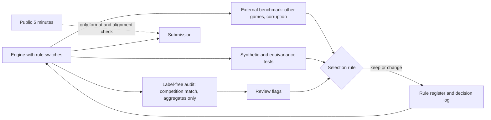
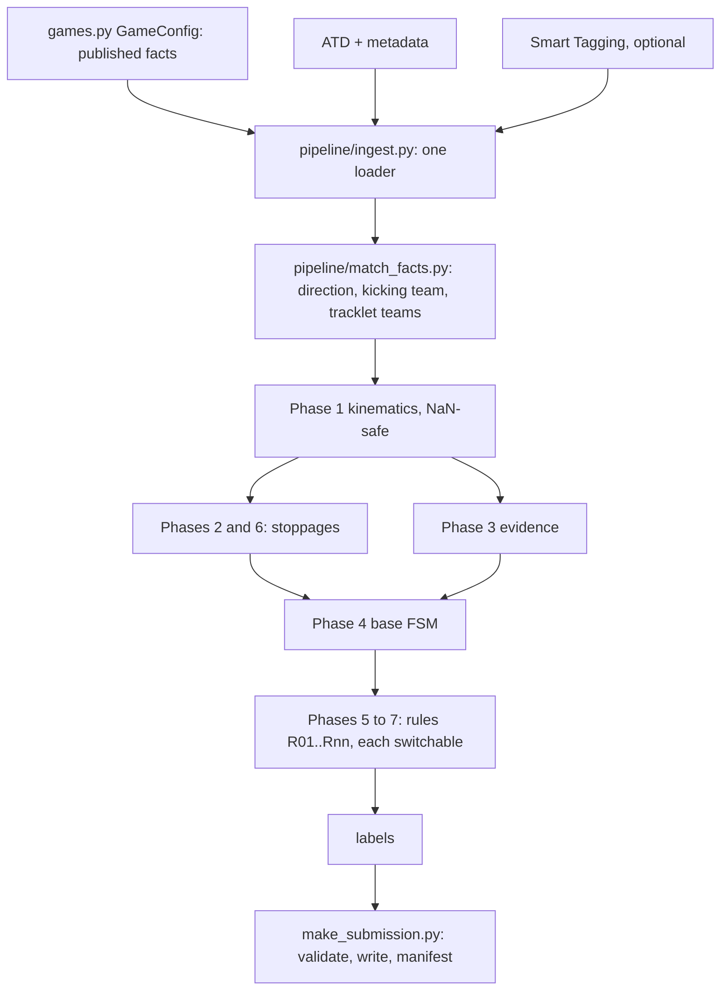

# Design

> Status: proposed, not approved. Code references are to `origin/main` at `54998ee`. Nothing in this
> document comes from running code on match data.

## Context

The engine is a seven-phase heuristic state machine (`strategies/football_engine.py`). It scores 0.9375
on the public window, a number reached by iterating against that window and by fixing cases seen in the
video (`supporting/experiments-analysis.md`). Its full-match quality is unknown and cannot be measured
before submission. It cannot run on other games, because of hardcoded frames, teams, sides and slots.

Constraints: deadline 2026-11-17; three people; no leaderboard; agents never touch match data, so
anything that needs it is run by a human, who reports aggregates, hashes or pass/fail only.

## Target Architecture

One loop replaces "score on the public window, watch, patch":

The engine keeps its structure. It changes in four ways: published facts come from configuration,
other facts are inferred, each rule gets a switch and an identifier, and missing values stay missing.

## Affected Components

| Component | Change |
|---|---|
| `strategies/football_engine.py` | Remove class-A constants; NaN-safe speeds; rule identifiers and switches read from `config/engine.toml`; no change in logic beyond that until ablation decisions |
| `pipeline/match_facts.py` (new) | Inference of direction, kicking team, tracklet team |
| `pipeline/ingest.py` (new) | Replaces the parsers in `run_experiment.py` and `pipeline/runner.py`; optional hash-keyed cache |
| `pipeline/dead_ball.py` | Frame tuples and club names removed; boundaries from config; team mapping from metadata |
| `games.py` | `GameConfig` view of published facts |
| `make_submission.py`, `config/engine.toml` (new) | Single entrypoint, versioned switches and parameters |
| `validation/` (new) | Register, Metrica adapter, references, corruption, benchmark |
| `tools/match_audit.py` (new) | Label-free aggregate audit |
| `run_experiment.py`, `tools/agent_eval.py` | Stop automatic public scoring and logging; `--test-all` fails properly |
| `tools/regression_check.py` | Local comparison of two runs, without metric floor or tracked snapshot |
| `tools/sweep_hysteresis.py`, `tests/test_golden_spells.py`, `tests/baseline/*` | Removed from tree, logged |
| `tools/generate_subtitles.py` | Constants and public-GT overlay removed; stays a local viewer |
| `pipeline/runner.py`, `pipeline/state_machine.py` | Retired |
| Docs and agent guidance | `AGENTS.md` section 7, `DEVELOPING.md`, `APPROACH.md`, skill updated |

## Data Flow and Interfaces

- `GameConfig`: `n_frames`, `fps`, `pitch_m`, `graded`, `frame_id_base`. Built from `games.py` for the
  competition match, and by adapters for external games.
- `MatchFacts`: `attack_dir[(half, team)]` in {+1, -1, 0}; `kickoff_team[half]` in {0, 1, -1};
  `tracklet_team (n, k) int8` with confidence. 0 or -1 means unknown and disables dependent rules.
- `TrackingContext` (kept for compatibility) gains `config: GameConfig` and `facts: MatchFacts`.
  Decisions now inside it (`dead_ball_mask`, `restarts`) stay during this change.
- `EngineConfig` (`config/engine.toml`): `rules.<id> = true|false`, plus parameters with `unit` and
  `provenance` in {physics, official, external:<dataset>, legacy-unverified}.
- Benchmark: `run(engine_config, suite) -> Report` with per-game metrics from the official functions.
- Audit: `audit(ctx, engine_config) -> dict` of aggregates only.

Direction inference: sign of the median x of each team's tracklets per half, over frames with at least
seven valid players per team. Kicking team: the team of the first player within control distance of
the ball after it leaves the centre spot at the half's start, else a kickoff tag, else unknown.
Goalkeeper-like segments: per team, the tracklet segment that stays deepest towards the inferred own
goal, checked against metadata team.

## Decisions and Alternatives

| ID | Decision | Rejected | Why |
|---|---|---|---|
| G1 | Generalise the existing engine | Rewrite; probabilistic decoder | Least risk in nine days; the benchmark must exist first |
| G2 | Switches before removals | Delete suspicious rules directly | Evidence decides; easy rollback |
| G3 | Metrica sample games first | Start with IDSSE or SkillCorner | Same vendor and format family, kloppy support, smallest adapter |
| G4 | No public-window floor | Keep 0.9375 as a gate | Selection on the window; it blocks generalising changes |
| G5 | Label-free audit is diagnostic | Use audit statistics as targets | Optimising them would recreate overfitting |
| G6 | Remove golden frame tests from the tree, keep history | Keep them as regression only | `RULES.md` excludes hand labels on the game for validation |
| G7 | No new runtime dependency; kloppy only in `validation` extra | Add SciPy, FilterPy | No need shown |

## Dependencies

Runtime: Python 3.11, NumPy, pandas (pinned by `uv.lock`). Development: pytest, Ruff, uv. Validation
extra: kloppy, at the starter's pinned 3.18.0 unless an adapter needs otherwise.

## Complexity and Performance

Inference cost is unchanged except for match-fact inference, which is linear in frames times slots.
`player_xy` is about 73 MB as float32 (calculated). The external benchmark runs the engine once per game,
variant and corruption level. Each run's time is UNVERIFIED and is measured in task 2.6 to size the suite.

## Reproducibility

Deterministic engine; seeded corruption; single entrypoint writing atomically after official
validation; manifest with commit, config hash, input hashes, environment, output hash; cache optional
and proven equal to no cache; frozen suite hash recorded before comparisons.

## Testing Strategy

| Requirement area | Tests |
|---|---|
| Compliance | AST scan for match literals and club names; scan for frame-window assertions; no public-GT gates; tracked-label check |
| Generalisation | match facts on synthetic matches; mirror, swap, permutation; NaN speed; rule switches; rule coverage; register completeness |
| Validation | register refusals; adapter fixture; references on synthetic events; corruption determinism; report fields |
| Audit | synthetic run; aggregate-only output check; permutation stability |
| Submission | two-run hash; cache equality; failure leaves no file; config errors; tests fail when strategies fail |

A seeded synthetic generator (`tests/synthetic/`) produces matches long enough to reach every phase.
CI uses only synthetic data and small team-written fixtures.

## Security and Confidentiality

Agents and CI never open match assets, caches or outputs derived from them. `validation/` refuses the
competition game. The audit prints aggregates only and writes to an ignored path. External data stays
out of Git. Humans share only hashes, pass/fail and aggregate audit summaries.

## Compatibility

`BaseStrategy.predict(TrackingContext)` stays. Other strategies keep working with defaults.
Developers stop using the public score and golden cases as feedback, and use the benchmark, audit and
synthetic tests instead. Commands in docs change in the same PRs.

## Rollback and Migration

Order: compliance and gates, environment, config and match facts, constants removal, entrypoint,
switches, then benchmark and audit in parallel, then ablation and improvements. Each step is a separate
revertible PR. The G1 fallback tag stays available until submission.

## Integration Plan

Implementation PRs declare `OpenSpec-Change: generalize-football-engine`, update `verification.md`, and
the last one archives the change. One person holds `strategies/football_engine.py` at a time. Owners
and dates are in `supporting/roadmap.md`.

## Possession Engine Considerations

### Temporal Alignment

Row i is tactical video frame i. ATD `frame_id - 1` as `DATA.md` states. Smart Tagging
`round(seconds * fps)`. External adapters declare their own conversion. Halves come from published
graded intervals or adapter metadata.

### Missing Observations

NaN stays NaN. Speeds across gaps are undefined. Distances are NaN, not 99.0. Rules treat unknown as
unknown and do not read it as stationary or far away.

### Geometric Assumptions

Pitch size from config. Halfway, boxes and corner arcs derived from pitch size and the Laws of the
Game, not 52.5 or fixed coordinates. Direction inferred per half. 2D projection of aerial balls remains
a known limit.

### Inference Uncertainty

No abstention model. `fill_abstentions` in the official scorer makes a graded `X` worth the previous
label for spellF1, while macroF1 charges it as a miss, so the engine writes explicit labels on graded
frames and `X` only on ungraded ones. Uncertainty is reported only in audit aggregates.

### H/A/D/X Semantics

Unchanged from the current engine: H and A for controlled possession including passes in flight, D
for stoppages, X outside graded intervals. Published pre-kickoff graded frames are D.

### Segmentation Impact

The ablation reports spell count ratio and false-split rate per rule on external games. The audit
reports spell duration and short-spell share inside and outside the public window.

### Smart Tagging Interaction

Current use continues, with team names mapped from metadata. External games have no Smart Tagging, so
tag-dependent rules are ablated with simulated tags or reported as untested externally.

### Overfitting Risk

High today. Controls: compliance tests, no public gates, no frame-motivated changes, external selection
with a frozen rule, audit flags for rules concentrated in the public window, and parameter provenance.
Residual: the team has watched the match, so design intuition is not independent. This is stated in the
technical document.

### Determinism

No randomness in the engine. Corruption and bootstrap use fixed seeds. Stable sorting and fixed
tie-breaks. Pinned environment.
